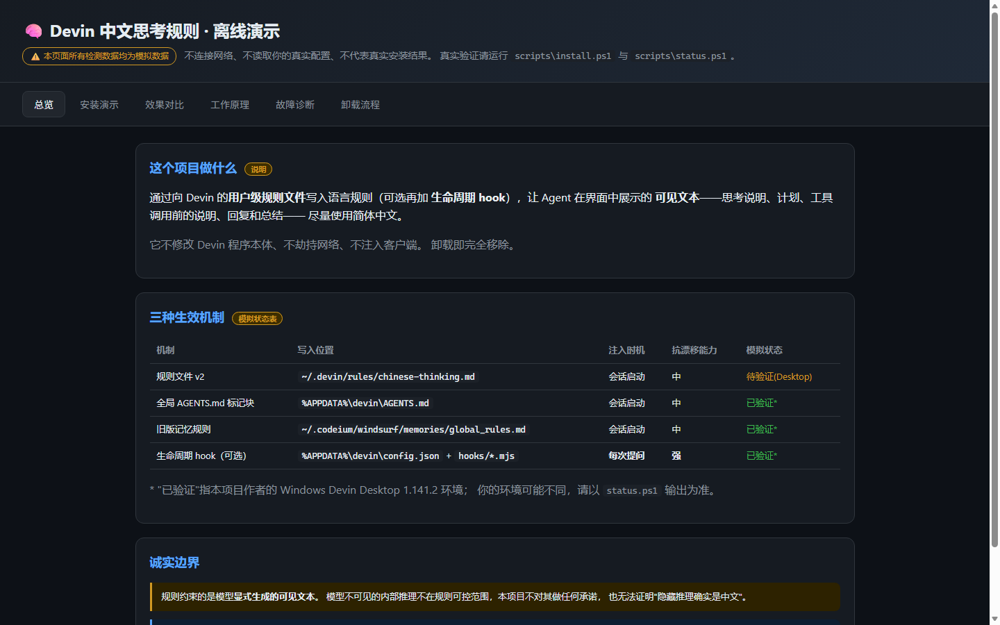

<div align="center">

# 🧠 Devin Chinese-Thinking Rules

**Make the visible text Devin / SWE-2 / SWE-2 Flash shows in its UI — thinking notes, plans, pre-tool-call notes, replies, and summaries — output primarily in Simplified Chinese**

[](LICENSE)
[]()
[]()

[Quick Start](#-quick-start) · [Live Demo](demo/index.html) · [How It Works](docs/中文思考规则实现原理.md) · [Install Guide](docs/Windows安装与卸载.md) · [Verification](docs/真实效果验证.md) · [中文](README.md)

</div>

---

## ⚠️ What it does — and does not do

| ✅ It can | ❌ It cannot |
|---|---|
| Make the agent **lean toward** Simplified Chinese for visible text via rule files + optional hooks | Guarantee 100% drift-free output (long contexts, mode switches can still produce English) |
| Constrain **visible** thinking notes, plans, tool notes, replies | Control the model's **invisible internal reasoning** (unobservable, unprovable) |
| One-click install with backup, idempotency, safe uninstall — never touches the Devin binary | Modify the Devin install directory, hijack network traffic, or inject the client |
| Optionally translate text you paste out via local Ollama | Auto-scrape the UI for real-time translation (no official API; not implemented) |

> **"Rules requesting Chinese output" ≠ "proof that hidden internal reasoning is Chinese".**
> This project only constrains text the model explicitly generates and shows you.

## 🎯 What is actually supported today

| Product / Mechanism | Status | Evidence |
|---|---|---|
| Devin Desktop 1.141.2 + SWE-2 | ✅ Verified this session | This repo's own V2 upgrade session |
| Rule files (AGENTS.md / codeium memories) | ✅ Confirmed loaded | rules blocks in session system prompt |
| Lifecycle hooks (re-inject every prompt) | ✅ Official docs + live on this machine | `lifecycle-hooks.mdx` + injection observed |
| `~/.devin/rules/*.md` | ⚠️ Documented; Desktop load untested | official `rules.mdx` |
| Devin CLI | ⚠️ Same mechanism, untested | no CLI on this machine |
| macOS / Linux | ⚠️ Documented paths; scripts are Windows-only | — |
| Ollama translate prototype | ✅ `--mock` tested; real translation unverified | needs local Ollama |

See [`docs/真实效果验证.md`](docs/真实效果验证.md) (verification log) and
[`docs/V2升级验收报告.md`](docs/V2升级验收报告.md) (acceptance report).

## 🚀 Quick Start (Windows)

```powershell
git clone https://github.com/lvhaotian4-max/devin-chinese-thinking
cd devin-chinese-thinking

# Install rules (new + legacy paths; auto-backup, idempotent, never overwrites your rules)
powershell -ExecutionPolicy Bypass -File scripts\install.ps1 -Targets all

# Recommended: also install the hook — re-injects the language rule every prompt (needs node)
powershell -ExecutionPolicy Bypass -File scripts\install.ps1 -Targets all -IncludeHooks

# Check status (read-only)
powershell -ExecutionPolicy Bypass -File scripts\status.ps1

# Restart Devin Desktop or open a new session, then give the agent any task
```

Uninstall:

```powershell
powershell -ExecutionPolicy Bypass -File scripts\uninstall.ps1          # preview + confirm
powershell -ExecutionPolicy Bypass -File scripts\uninstall.ps1 -Force    # uninstall directly
powershell -ExecutionPolicy Bypass -File scripts\uninstall.ps1 -Restore  # roll back from .bak
```

Manual setup, project-scope install, and macOS/Linux paths:
[`docs/Windows安装与卸载.md`](docs/Windows安装与卸载.md) and
[`docs/完整运行流程.md`](docs/完整运行流程.md).

## 🖥️ Live Demo

[`demo/index.html`](demo/index.html) — a fully offline HTML demo; double-click to open,
no network needed. Simulated config detection, install walkthrough,
English-vs-Chinese comparison, how it works, troubleshooting, and uninstall flow.
**All detection data on the page is simulated** and clearly labeled.



Real effect screenshot (author's earlier test, v1 config, single session):


## 🧩 How it works (short version)

```
rule templates → install.ps1 writes + backs up → Devin injects at session start
               → hook re-injects on every prompt → model leans toward Chinese
               → UI shows Chinese visible text
```

Three stackable mechanisms: `~/.devin/rules/*.md` (`always_on`),
a marked block in `%APPDATA%\devin\AGENTS.md`, and legacy codeium memories —
plus an optional hook (`config.json` → `SessionStart`/`UserPromptSubmit`
→ `additionalContext`, the strongest anti-drift layer).

Full chain and boundaries:
[`docs/中文思考规则实现原理.md`](docs/中文思考规则实现原理.md)

## 🧪 Verification & tests

```powershell
# Sandboxed automated tests (15 cases, never touches real config)
powershell -ExecutionPolicy Bypass -File scripts\test.ps1

# Visible-text drift stats (save text copied from the Devin UI as .txt)
python tests\check_drift.py visible.txt
python tests\check_drift.py --compare base.json new.json

# Optional: local Ollama translation (only text you provide)
python scripts\translate_ollama.py visible.txt --mock   # offline demo
python scripts\translate_ollama.py visible.txt          # needs local Ollama
```

V2 acceptance: sandbox tests **15/15 pass**, Python unit tests **19/19 pass**,
Chinese output verified live in this session. Full records:
[`docs/V2升级验收报告.md`](docs/V2升级验收报告.md).

## 📁 Repository layout

```
devin-chinese-thinking/
├── README.md / README.en.md
├── CHANGELOG.md
├── demo/index.html               ← offline demo (simulated data labeled)
├── docs/                         ← audit, principles, install, verification, FAQ, limits
├── templates/                    ← v2 always_on rule + legacy templates
├── scripts/                      ← install / status / uninstall / test / translate
├── assets/hooks/                 ← hook script template
├── assets/screenshots/           ← real renders of the demo
└── tests/                        ← check_drift.py + unit tests
```

## ❓ FAQ

**Q: Does it guarantee 100% Chinese thinking notes?**
A: No. Rules raise the tendency; long contexts, mode switches, and model
versions can still drift. `-IncludeHooks` is the strongest anti-drift option.

**Q: Can rules control "real internal reasoning"?**
A: No — and we don't claim it. Only the *visible* UI text is constrained.

**Q: Will it overwrite my other rules?**
A: No. Writes either create new files or append marked blocks; unmanaged
files are reported as conflicts, never overwritten; uninstall removes only
project-managed content.

**Q: Will it break after a Devin update?**
A: Rule files are user-level config and generally survive updates; if paths
change, `status.ps1` shows MISSING — defer to official docs.

**Q: macOS / Linux?**
A: Manually place `templates/chinese-thinking-v2.md` in `~/.devin/rules/`
or append its body to `~/.config/devin/AGENTS.md`. PowerShell scripts are
Windows-only.

**Q: Is Ollama required?**
A: No. It's optional, for translating English visible text you paste out.

## 📄 License

[MIT](LICENSE)
