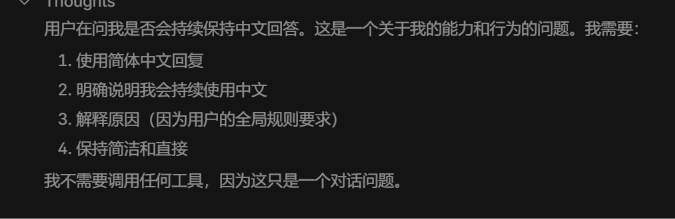

<div align="center">



# 🧠 Devin Thinking Chain Localization Guide

**Make Devin / SWE-2 / SWE-2 Flash visible thinking notes (Thoughts / reasoning trace) output primarily in Simplified Chinese**

[](LICENSE)
[]()
[](https://devin.ai)

[Quick Start](#-quick-start) · [How It Works](docs/mechanism.md) · [Templates](#-ready-to-copy-templates) · [FAQ](#-faq) · [中文](README.md)

</div>

---

## ✨ Preview

Once configured, the **thinking notes, plans, pre-tool-call explanations, and summaries shown to you** will be primarily in Simplified Chinese instead of the default English.

> 💡 Thinking notes are the visible part of the model's "inner monologue". Switching them to Chinese makes it much easier to review the AI's reasoning and debug agent behavior.
> Note: rules raise the *tendency* toward Chinese, not a hard guarantee — model versions, long contexts, and mode switches can still cause drift. Invisible internal reasoning is outside the rules' control. See [Compatibility](docs/compatibility.md).


## 🎯 Compatibility

| Product / Model | Status | Notes |
|---|---|---|
| Devin Desktop (IDE built-in Agent) | ✅ Author-tested | See `assets/screenshot.jpg`; single-session evidence |
| Devin CLI | ⚠️ Mechanism confirmed | Official docs confirm rule loading; language effect pending retest |
| SWE-2 Flash | ✅ Author-tested | Same as above |
| `.devin/rules` v2 template | ⚠️ Pending manual test | Docs confirm `always_on` support; see [test matrix](docs/manual-test-matrix.md) |
| Other Windsurf-rules-based Agents | ⚠️ Theoretically compatible | Not tested |

## 🚀 Quick Start

The whole setup takes **about 2 minutes**. Windows users can use the one-click script; manual setup also works.

### Option A: One-click script (Windows, recommended)

```powershell
git clone https://github.com/lvhaotian4-max/devin-chinese-thinking
cd devin-chinese-thinking
powershell -ExecutionPolicy Bypass -File scripts\install.ps1 -Targets all
```

- Detects both new paths (`~/.devin/rules/`, `%APPDATA%\devin\AGENTS.md`)
  and legacy paths (`.codeium/windsurf/memories/global_rules.md`);
- Backs up existing files to `.bak-<timestamp>` before modifying;
  idempotent on re-run; never overwrites unmanaged files.

Verify and maintain:

```powershell
powershell -ExecutionPolicy Bypass -File scripts\doctor.ps1      # read-only check
powershell -ExecutionPolicy Bypass -File scripts\uninstall.ps1   # uninstall (-Restore to undo)
```

### Option B: Manual setup

Devin reads several kinds of always-on rule files — **prefer `.devin/rules/` for new setups**:

| File path | Scope | Generation |
|---|---|---|
| `%USERPROFILE%\.devin\rules\chinese-thinking.md` (Windows)<br>`~/.devin/rules/chinese-thinking.md` (macOS/Linux) | Global | New, supports `trigger: always_on` |
| `%APPDATA%\devin\AGENTS.md` (Windows)<br>`~/.config/devin/AGENTS.md` (macOS/Linux) | Global | New |
| `%USERPROFILE%\.codeium\windsurf\memories\global_rules.md` | Global | Legacy, still read |

> Windows example: `C:\Users\<you>\.devin\rules\chinese-thinking.md`

If the file doesn't exist, **create it**; if it exists, **append** the rule — do not overwrite existing rules.

### Add the language rule

Copy the **full content** of [`templates/chinese-thinking-v2.md`](templates/chinese-thinking-v2.md) (including frontmatter) as a rule file under `.devin/rules/`; or append just the **body** to `AGENTS.md` / `global_rules.md`.

v2 improvements over v1:

- Covers visible analysis, plans, tool-call notes, subagent output, errors, and summaries;
- Addresses drift from English logs, English code, long contexts, and mode switches;
- Explicitly preserves code, paths, APIs, SQL, JSON, and log originals;
- Clearly separates visible Thoughts from invisible internal reasoning;
- More concise, reducing context overhead.

The original compact template remains at [`templates/language-rules.md`](templates/language-rules.md).

### Step 3: Restart and verify

1. Restart Devin (or open a new session) so the rules reload;
2. Give the agent any task, e.g. `list the files in this folder`;
3. Watch the thinking chain output — it should be entirely in Chinese.

## 📁 Repository Structure

```
devin-chinese-thinking/
├── README.md                  ← This guide (Chinese)
├── README.en.md               ← This file (English)
├── CHANGELOG.md               ← Changelog
├── docs/
│   ├── mechanism.md           ← Deep dive: why this works
│   ├── compatibility.md       ← Rule-loading audit + tested-environment log
│   ├── manual-test-matrix.md  ← Manual test matrix (real Devin runs)
│   └── ollama-fallback.md     ← Optional local translation fallback (design)
├── templates/
│   ├── chinese-thinking-v2.md ← v2 rule template (.devin/rules, always_on)
│   ├── language-rules.md      ← v1 compact template (still usable)
│   └── project-agents.md      ← Project-level AGENTS.md template
├── scripts/                   ← Windows one-click scripts (install/doctor/uninstall)
├── tests/                     ← check_drift.py + offline unit tests
├── assets/                    ← banner, screenshot, QR codes
└── LICENSE                    ← MIT
```

## 💡 Advanced Usage

### Apply to a single project only

If you don't want global localization, put the rules in the **project root `AGENTS.md`** so they only apply to that repo's sessions. See [`templates/project-agents.md`](templates/project-agents.md).

### Coexist with other rules

Language rules are just one of many always-on rules. You can combine them with code style, build commands, and security policies in the same file — Devin follows them all together. Placing language rules near the **top** of the file gives them higher weight.

### Subagents are covered too

The v2 rule requires subagent visible output to follow the same language rule and suggests restating "visible output in Simplified Chinese" in subagent task descriptions.

### If drift happens: measure visible text offline

Save text copied from the Devin UI as `.txt` and measure the Chinese/English split with `tests/check_drift.py`:

```bash
python tests/check_drift.py visible.txt          # JSON report
python tests/check_drift.py visible.txt --format csv
python tests/check_drift.py --compare base.json new.json
```

It excludes code blocks, logs, URLs, paths, and technical identifiers. **Note**: it only analyzes text you provide — it does not read hidden reasoning and cannot alone prove the rules work. See [docs/manual-test-matrix.md](docs/manual-test-matrix.md).

### Optional: local Ollama translation fallback (design only)

If rules don't fully take effect, a local Ollama instance could translate copied English visible text into Chinese. Currently design-only — see [docs/ollama-fallback.md](docs/ollama-fallback.md). It does not touch the Devin install directory or network layer, and can be disabled independently.

## ❓ FAQ

**Q: Do I need to configure both files?**
A: No, one is enough. On Windows, `scripts\install.ps1 -Targets all` sets up both new and legacy paths at once.

**Q: Can it guarantee 100% Chinese thinking notes?**
A: No. Rules raise the tendency toward Chinese, but model versions, long contexts, and mode switches can still cause drift. Use `tests/check_drift.py` to quantify drift in visible text; real-world results should be verified manually (see the test matrix).

**Q: Can rules control "real internal reasoning"?**
A: No — and we don't claim so. Invisible internal reasoning is outside rule control. This project constrains the *visible* thinking notes, plans, tool notes, and replies shown in the UI. Visible text is generated in Chinese directly rather than translated afterwards (an experience-based observation, not benchmark-verified).

**Q: Will it affect code comments and output language?**
A: v2 defaults code comments to Simplified Chinese while keeping technical identifiers (variable names, API names, paths, SQL, JSON, log originals) verbatim. If you want English code comments, remove the corresponding clause.

**Q: Will it stop working after a Devin update?**
A: Rule files are user-level config and generally survive product updates; but if Devin changes rule paths or loading, legacy paths may stop working — check the official docs and run `doctor.ps1`.

**Q: Can it be localized to other languages?**
A: Yes. Replace "Simplified Chinese" with your target language (e.g. English, 日本語) — the principle is the same.

## 🙏 Acknowledgements

This approach comes from configuration practices verified in real-world use. Thanks to the Devin / Windsurf rules system for supporting user-defined instructions.

## ☕ Support

If this project helped you, consider buying me a coffee ☕

| WeChat Pay | Alipay |
|---|---|
|  |  |

> Donations are entirely voluntary — a Star ⭐ is the greatest support!

## 📄 License

[MIT](LICENSE) — use it freely, and welcome a Star ⭐
