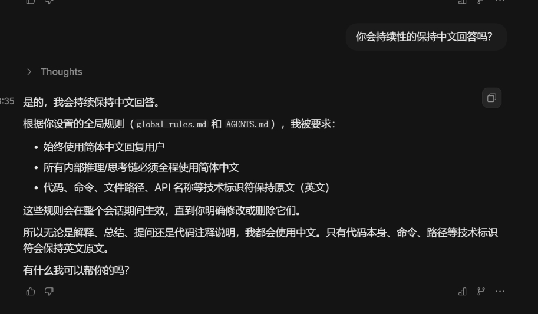

<div align="center">


# 🧠 Devin Thinking Chain Localization Guide

**Make Devin / SWE-2 / SWE-2 Flash internal reasoning (thinking / reasoning) output entirely in Simplified Chinese**

[](LICENSE)
[]()
[](https://devin.ai)

[Quick Start](#-quick-start) · [How It Works](docs/mechanism.md) · [Templates](#-ready-to-copy-templates) · [FAQ](#-faq) · [中文](README.md)

</div>

---

## ✨ Preview

Once configured, Devin's **internal thinking process** (thinking chain / reasoning trace) will be presented in Simplified Chinese instead of the default English — across plan mode, subagents, and pre-tool-call reasoning alike.

> 💡 The thinking chain is the model's "inner monologue". Switching it to Chinese makes it much easier to review the AI's reasoning logic and debug agent behavior.



## 🎯 Compatibility

| Product / Model | Status |
|---|---|
| Devin Desktop (IDE built-in Agent) | ✅ Verified |
| Devin CLI | ✅ Verified |
| SWE-2 Flash | ✅ Verified |
| Other Agents based on the Windsurf rules system | ✅ Should work |

## 🚀 Quick Start

The whole setup takes **about 2 minutes**, in three steps:

### Step 1: Find your rules file

Devin loads two kinds of **always-on** rule files:

| File path | Scope | Description |
|---|---|---|
| `~/.codeium/windsurf/memories/global_rules.md` | Global | Windsurf memory rules, applies to all sessions |
| `~/AppData/Roaming/devin/AGENTS.md` (Windows)<br>`~/.config/devin/AGENTS.md` (macOS/Linux) | Global | Devin global agent rules |

> Windows example: `C:\Users\<your-username>\AppData\Roaming\devin\AGENTS.md`

If the file doesn't exist, **create it**; if it exists, **append** the content below — do not overwrite existing rules.

### Step 2: Add the language rule

Add the following to any one of the files above (or both for extra safety):

```markdown
## Language

- Always reply to the user in Simplified Chinese, including all explanations,
  summaries, questions, and code comment descriptions.
- All internal reasoning/thinking must be entirely in Simplified Chinese;
  do not produce English thinking chains. This applies to Devin, SWE-2,
  subagents, plan mode, and pre-tool-call reasoning; if the model defaults
  to English thinking, it must switch to Simplified Chinese immediately.
- Keep code itself, commands, file paths, API names, and other technical
  identifiers in their original form (English); do not translate them.
- Commit messages and PR descriptions should also be in Chinese unless the
  project has other conventions.
```

Full template: [`templates/language-rules.md`](templates/language-rules.md).

### Step 3: Restart and verify

1. Restart Devin (or open a new session) so the rules reload;
2. Give the agent any task, e.g. `list the files in this folder`;
3. Watch the thinking chain output — it should be entirely in Chinese.

## 📁 Repository Structure

```
devin-chinese-thinking/
├── README.md                  ← This guide (Chinese)
├── README.en.md               ← This file (English)
├── docs/
│   └── mechanism.md           ← Deep dive: why this works
├── templates/
│   ├── language-rules.md      ← Full language-rules template (copy-ready)
│   └── project-agents.md      ← Project-level AGENTS.md template
└── LICENSE                    ← MIT
```

## 💡 Advanced Usage

### Apply to a single project only

If you don't want global localization, put the rules in the **project root `AGENTS.md`** so they only apply to that repo's sessions. See [`templates/project-agents.md`](templates/project-agents.md).

### Coexist with other rules

Language rules are just one of many always-on rules. You can combine them with code style, build commands, and security policies in the same file — Devin follows them all together. Placing language rules near the **top** of the file gives them higher weight.

### Subagents are covered too

The rule explicitly covers "subagents, plan mode, and pre-tool-call reasoning", so even when the agent spawns a subagent for search or exploration, the subagent's thinking chain stays in Chinese.

## ❓ FAQ

**Q: Do I need to configure both files?**
A: No, one is enough. Configuring both adds redundancy in case one rule chain fails to load.

**Q: Is the thinking chain "real internal reasoning" or a display-layer translation?**
A: The model generates reasoning directly in Chinese — it is not translated afterwards, so reasoning quality is unaffected.

**Q: Will it affect code comments and output language?**
A: The rule also constrains reply language. Code identifiers (variable names, API names, etc.) stay in English; if you want code comments in English too, just remove the "code comment descriptions" clause from the rule.

**Q: Will it stop working after a Devin update?**
A: Rule files are user-level configuration and are not overwritten by product updates.

**Q: Can it be localized to other languages?**
A: Yes. Replace "Simplified Chinese" with your target language (e.g. English, 日本語) — the principle is the same.

## 🙏 Acknowledgements

This approach comes from configuration practices verified in real-world use. Thanks to the Devin / Windsurf rules system for supporting user-defined instructions.

## ☕ Support

If this project helped you, consider buying me a coffee ☕

| WeChat Pay | Alipay |
|---|---|
|  |  |

> Donations are entirely voluntary — a Star ⭐ is the greatest support!

## 📄 License

[MIT](LICENSE) — use it freely, and welcome a Star ⭐
