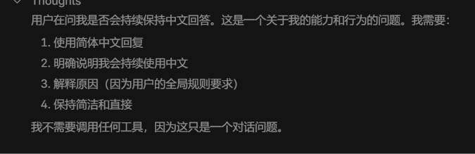
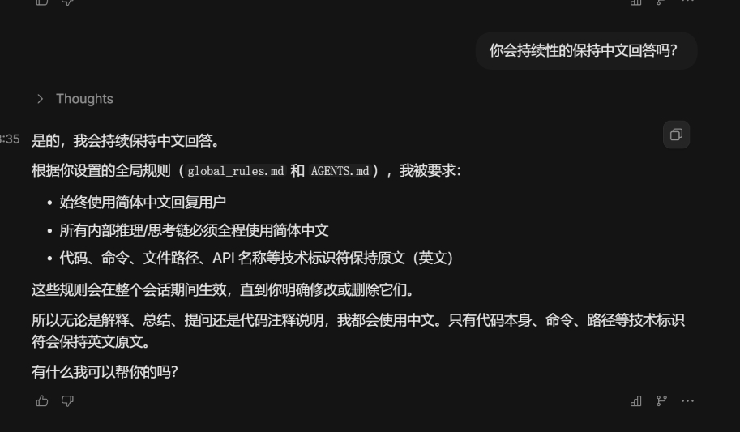

<div align="center">



# 🧠 Devin 思考链汉化指南

**让 Devin / SWE-2 / SWE-2 Flash 的内部推理（thinking / reasoning）全程使用简体中文输出**

[](LICENSE)
[]()
[](https://devin.ai)

[快速开始](#-快速开始) · [原理解析](docs/mechanism.md) · [模板下载](#-可直接复制的模板) · [常见问题](#-常见问题-faq) · [English](README.en.md)

</div>

---

## ✨ 效果预览

配置完成后，Devin 在执行任务时的**内部思考过程**（thinking chain / reasoning trace）将以简体中文呈现，而不是默认的英文。无论是计划模式、子代理（subagent）、还是工具调用前的推理，全部遵循同一语言规则。

> 💡 思考链是模型的"内心独白"，把它变成中文后，审查 AI 的推理逻辑、调试 Agent 行为都会方便得多。



## 🎯 适用范围

| 产品 / 模型 | 是否有效 |
|---|---|
| Devin Desktop（IDE 内置 Agent） | ✅ 已验证 |
| Devin CLI | ✅ 已验证 |
| SWE-2 Flash | ✅ 已验证 |
| 其他基于 Windsurf 规则体系的 Agent | ✅ 理论上同样有效 |

## 🚀 快速开始

整个配置只需要 **2 分钟**，分为三步：

### 第 1 步：找到你的规则文件

Devin 会读取两类"始终生效"（always-on）的规则文件：

| 文件路径 | 作用域 | 说明 |
|---|---|---|
| `~/.codeium/windsurf/memories/global_rules.md` | 全局 | Windsurf 系记忆规则，对所有会话生效 |
| `~/AppData/Roaming/devin/AGENTS.md`（Windows）<br>`~/.config/devin/AGENTS.md`（macOS/Linux） | 全局 | Devin 全局 Agent 规则 |

> Windows 上的实际路径示例：`C:\Users\<你的用户名>\AppData\Roaming\devin\AGENTS.md`

如果文件不存在，**直接创建**即可；如果已存在，**追加**下面的内容，不要覆盖原有规则。

### 第 2 步：写入语言规则

把以下内容加入上述任意一个（或两个都加入，更保险）规则文件：

```markdown
## 语言

- 始终使用简体中文回复用户，包括所有解释、总结、提问和代码注释说明。
- 所有内部推理/思考链（thinking/reasoning）必须全程使用简体中文；
  不要生成英文思考链。此要求适用于 Devin、SWE-2 及子代理、
  计划模式和工具调用前的推理；若模型默认倾向英文思考，
  必须直接改用简体中文继续推理。
- 代码本身、命令、文件路径、API 名称等技术标识符保持原文
  （英文），不要翻译。
- 提交信息、PR 描述等面向协作的内容，除非项目有其他约定，
  否则也使用中文。
```

完整版模板见 [`templates/language-rules.md`](templates/language-rules.md)。

### 第 3 步：重启会话并验证

1. 重启 Devin（或新开一个会话），让规则重新加载；
2. 随便给 Agent 一个任务，例如：`帮我看看这个文件夹里有什么`；
3. 观察 Agent 的思考链输出 —— 应该全程是中文。

## 📁 本仓库结构

```
devin-chinese-thinking/
├── README.md                  ← 本文件：快速上手指南
├── docs/
│   └── mechanism.md           ← 深度解析：为什么这样能生效
├── templates/
│   ├── language-rules.md      ← 语言规则完整模板（可直接复制）
│   └── project-agents.md      ← 项目级 AGENTS.md 模板（只对单个仓库生效）
└── LICENSE                    ← MIT 协议
```

## 💡 进阶用法

### 只对某一个项目生效

如果你不想全局汉化，可以把规则写进**项目根目录的 `AGENTS.md`**，只对该仓库的会话生效。模板见 [`templates/project-agents.md`](templates/project-agents.md)。

### 与其他规则共存

语言规则只是众多 always-on 规则中的一条。你可以把它和代码风格、构建命令、安全规范等规则写在同一个文件里，Devin 会综合遵循。建议把语言规则放在文件**靠前的位置**，权重更高。

### 子代理也会被覆盖

规则中明确写了"适用于子代理、计划模式和工具调用前的推理"，这样即使 Agent 派生出 subagent 去做搜索或探索，子代理的思考链同样是中文。

## ❓ 常见问题 FAQ

**Q：必须两个文件都配置吗？**
A：不需要，任选其一即可。两个都配可以双保险，防止某条规则链没有被加载。

**Q：思考链是"真正的内部推理"还是显示层的翻译？**
A：模型思考时直接用中文生成推理内容，并非事后翻译，因此推理质量不受影响。

**Q：会影响代码注释和输出语言吗？**
A：规则同时约束了回复语言。代码标识符（变量名、API 名等）保持英文不受影响；如果你希望代码注释也用英文，只需删掉规则里"代码注释说明"那一条。

**Q：Devin 更新后会失效吗？**
A：规则文件是用户级配置，不会被产品更新覆盖，持续生效。

**Q：可以汉化成其他语言吗？**
A：可以。把"简体中文"替换成目标语言（如 English、日本語）即可，原理相同。

## 🙏 致谢

本方案源自实际使用中验证可行的配置实践，感谢 Devin / Windsurf 规则体系对用户自定义指令的支持。

## ☕ 打赏支持

如果这个项目对你有帮助，欢迎请我喝杯咖啡 ☕

| 微信支付 | 支付宝 |
|---|---|
|  |  |

> 打赏完全自愿，Star ⭐ 就是最大的支持！

## 📄 License

[MIT](LICENSE) — 随便用，欢迎 Star ⭐
